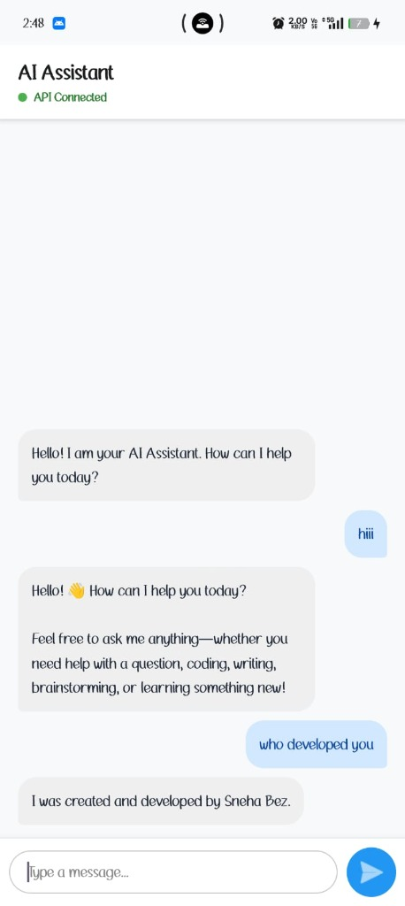

# 🤖 AIChatBot - Task 6

A responsive and intelligent native Android AI Chatbot application powered by **Google Gemini API**, built using **Kotlin**, **RecyclerView**, **Coroutines**, and **Material Design 3**.

---

## 👩‍💻 Developer
- **Developer:** Sneha Bez
- **Task:** Task 6 (Final Internship Task)

---

## 📸 App Preview

<p align="center">
  
</p>

---

## ✨ Features

- 🧠 **Google Gemini AI Integration:** Seamlessly communicates with Google Gemini API (`gemini-3.5-flash`, `gemini-3.8-flash`) to deliver smart, contextual conversational replies.
- 💬 **Dynamic Chat Interface:** Smooth RecyclerView-based messaging stream separating user questions and bot responses.
- 🎨 **Modern Bubble Layout:** Beautiful customized chat bubbles with distinct styling for sender and receiver.
- ⚙️ **Configurable API Key:** Easy settings dialog to insert or update your Gemini API key securely.
- 🧹 **Clear Chat History:** Reset or clear active conversations anytime with one click.
- ⚡ **Asynchronous Coroutines:** Network requests and API parsing are executed smoothly on background threads (`Dispatchers.IO`) without blocking the UI.
- 🛡️ **Smart Identity & Creator Recognition:** Custom identity rules recognizing creator **Sneha Bez**.

---

## 🛠️ Tech Stack & Libraries

- **Language:** Kotlin
- **Architecture:** Android Native (XML + Kotlin)
- **AI Engine:** Google Gemini Generative AI API (`gemini-3.5-flash`)
- **UI Components:** RecyclerView, CardView, MaterialButton, EditText
- **Async Execution:** Kotlin Coroutines (`Dispatchers.IO` / `Dispatchers.Main`)
- **HTTP Client / JSON:** OkHttp 4 / JSON Parser
- **IDE:** Android Studio

---

## 📁 Project Structure

```text
AIChatBot/
├── screenshots/
│   └── app_screenshot.jpg       # App preview screenshot
├── app/
│   ├── src/main/
│   │   ├── java/com/example/aichatboot20/
│   │   │   ├── ChatAdapter.kt       # RecyclerView adapter for message list
│   │   │   ├── ChatMessage.kt       # Data model for user & bot messages
│   │   │   └── MainActivity.kt      # Main chat screen & Gemini API calls
│   │   ├── res/
│   │   │   ├── drawable/            # Custom chat bubble drawables & action icons
│   │   │   ├── layout/
│   │   │   │   ├── activity_main.xml       # Main chat UI container
│   │   │   │   ├── item_user_message.xml   # User message bubble layout
│   │   │   │   └── item_bot_message.xml    # Bot message bubble layout
│   │   │   └── values/              # Colors, styles, and string resources
│   │   └── AndroidManifest.xml
│   └── build.gradle.kts
├── build.gradle.kts
└── settings.gradle.kts
```

---

## 🚀 How to Run

1. Open **Android Studio**.
2. Click **Open** and select the `AIChatBot` directory.
3. Allow Gradle to sync dependencies.
4. Add your Google Gemini API key via the in-app settings icon (or directly in the app).
5. Run the app on an Android Emulator or physical device (`Shift + F10`).

---

**Developed by Sneha Bez** | Task 6
